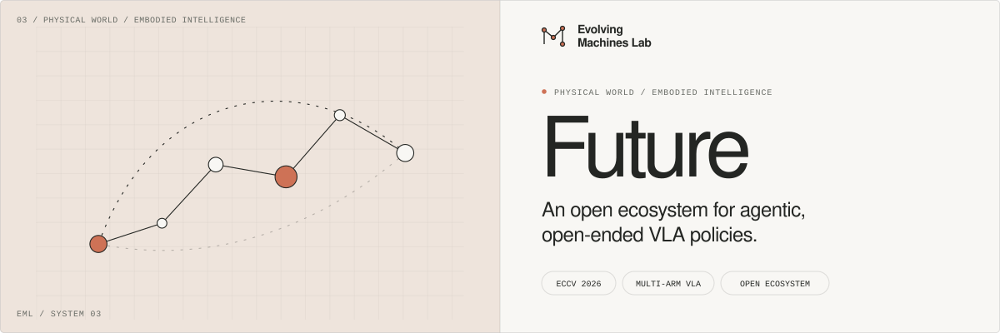

[](https://zhangzaibin.github.io/evolving-machines/)

<p align="center">
  <strong>Compositional robot intelligence, from atomic skills to open-ended agents.</strong>
</p>

<p align="center">
  <a href="https://github.com/zhangzaibin/future-robots"></a>
  <a href="https://arxiv.org/abs/2608.25864"></a>
  <a href="https://arxiv.org/abs/2610.06184"></a>
</p>

<p align="center">
  <a href="https://huggingface.co/datasets/MrBean2024/macg_data"></a>
  <a href="https://huggingface.co/MrBean2024/MA-VLA-pi05-shuffle06-mask04"></a>
  <a href="https://huggingface.co/MrBean2024/AE-VLA-full"></a>
</p>

<p align="center">
  <a href="https://zhangzaibin.github.io/evolving-machines/"><strong>Evolving Machines Lab</strong></a>
  &nbsp; · &nbsp;
  <a href="https://zhangzaibin.github.io/evolving-machines/research/arm-wise-cg/">▶ Film &amp; blog</a>
</p>

**Future** brings together **MA-VLA** (ECCV 2026) and **ACG-Bench / AE-VLA** (arXiv 2026), with public training data, model weights, and tools for compositional robot learning. We study how robots reuse atomic skills, assign them to different arms, and coordinate them in unfamiliar tasks.

Our long-term goal is **agentic, open-ended VLA policies** that connect task decomposition, execution, and feedback. The current benchmark studies execution with supplied per-arm prompts; autonomous planning remains a research direction.

<p align="center">
  <a href="#research">Research</a> &nbsp; / &nbsp;
  <a href="#public-resources">Resources</a> &nbsp; / &nbsp;
  <a href="#quick-start">Quick start</a> &nbsp; / &nbsp;
  <a href="#evaluation">Results</a> &nbsp; / &nbsp;
  <a href="#documentation">Docs</a> &nbsp; / &nbsp;
  <a href="#citation">Cite</a>
</p>

## Research

### MA-VLA · Multi-arm collaboration

[**MA-VLA: Multi-arm Vision-Language-Action Model for Collaboration and Compositional Generalization**](https://arxiv.org/abs/2608.25864) introduces atomic action assignment: cooperative tasks are expressed as mid-level instructions for individual arms. **Arm Shuffle** permutes arm observations, states, and assigned prompts during training to support reuse beyond fixed execution roles. Published at **ECCV 2026**.

The repository's [MA-VLA recipe](docs/training.md#ma-vla) uses a Pi0.5 backbone with phase-derived atomic instructions, arm shuffling, and image masking. Its [released checkpoint](https://huggingface.co/MrBean2024/MA-VLA-pi05-shuffle06-mask04) uses arm shuffle probability **0.6** and image masking probability **0.4**. This is the current two-arm multi-task implementation; the paper also studies other settings.

### ACG-Bench / AE-VLA · Arm-wise composition

[**Arm-wise Compositional Generalization in Dual-Arm Vision-Language-Action Models**](https://arxiv.org/abs/2610.06184) introduces **ACG-Bench** and studies three complementary design choices in **AE-VLA**:

- **Arm-token grouping:** represent each arm's actions with its own token group in a shared action expert.
- **SkillLoRA:** reuse skill-specific low-rank adapters, selected by a per-arm router.
- **Arm-wise attention:** structure information flow by arm while preserving shared scene context.

The full model combines all three. See the [research blog and demonstrations](https://zhangzaibin.github.io/evolving-machines/research/arm-wise-cg/) for the motivation, architecture, and robot videos, or the [training guide](docs/training.md#ae-vla) for the full model and ablation recipes.

## Public resources

| Resource | What's included |
| --- | --- |
| [🤗 **Training data**](https://huggingface.co/datasets/MrBean2024/macg_data) | LeRobot trajectories, per-arm instructions, phase annotations, and SkillLoRA labels |
| [🤗 **MA-VLA model**](https://huggingface.co/MrBean2024/MA-VLA-pi05-shuffle06-mask04) | Pi0.5 checkpoint with shuffle 0.6 / mask 0.4, plus normalization assets |
| [🤗 **AE-VLA model**](https://huggingface.co/MrBean2024/AE-VLA-full) | Full model parameters and normalization assets |
| [📄 **MA-VLA paper**](https://arxiv.org/abs/2608.25864) | Multi-arm collaboration and compositional generalization · ECCV 2026 |
| [📄 **AE-VLA paper**](https://arxiv.org/abs/2610.06184) | ACG-Bench, architecture study, and evaluation |
| [▶ **Film & blog**](https://zhangzaibin.github.io/evolving-machines/research/arm-wise-cg/) | Method walkthrough and simulation / SO101 demonstrations |

**700 episodes · 395,759 frames · 30 FPS · 3 RGB views**

The dataset uses LeRobot **v2.1**, with joint and gripper states for both arms, 16-dimensional actions, phase labels, and images embedded in parquet files. Its 34 task entries represent instructions, not benchmark task families. See the [dataset metadata](https://huggingface.co/datasets/MrBean2024/macg_data/blob/main/meta/info.json) and [data guide](docs/data.md#public-training-dataset) for the training split and file layout.

## Quick start

### 1. Install the environment

Training and inference use **Linux, NVIDIA GPUs, a CUDA 12-compatible driver, and Python 3.11+**. Install [uv](https://docs.astral.sh/uv/getting-started/installation/), then:

```bash
git clone https://github.com/zhangzaibin/future-robots.git
cd future-robots
GIT_LFS_SKIP_SMUDGE=1 uv sync --frozen
uv run python -c 'import jax; print(jax.devices())'
```

Follow the [installation guide](docs/installation.md) for pretrained Pi0.5 weights, local tokenizer paths, offline setup, and GPU configuration. The project retains the `openpi` Python import namespace.

### 2. Download the training data

Run from the repository root. This places the public dataset at the path used by the multi-task recipes:

```bash
uv run python - <<'PY'
from huggingface_hub import snapshot_download

snapshot_download(
    repo_id="MrBean2024/macg_data",
    repo_type="dataset",
    local_dir="dataset/multi_task_combined",
)
PY
```

The release includes `meta/skill_labels.jsonl`, required for full AE-VLA training. To use another location, set `DATASET_DIR=/path/to/dataset` when launching a recipe. For your own demonstrations, follow the [conversion and merging workflow](docs/data.md#simulation-data). Downloads use Hugging Face's [`snapshot_download`](https://huggingface.co/docs/huggingface_hub/guides/download); record the Hub revision for reproducible runs.

### 3. Train a policy

```bash
# Full AE-VLA: arm-token grouping + SkillLoRA + arm-wise attention.
# Preview the commands without loading data, weights, or a GPU.
bash scripts/macg_new/train_skill_lora.sh --dry-run
EXP_NAME=aevla_full_run1 bash scripts/macg_new/train_skill_lora.sh

# MA-VLA: atomic instructions with arm shuffle and image masking.
EXP_NAME=mavla_run1 bash scripts/macg_new/train_mavla.sh
```

<details>
<summary><strong>Baselines and ablations</strong></summary>

<br>

**Models and baselines**

- **Full AE-VLA** — arm-token grouping, SkillLoRA, and arm-wise attention. [Training script](scripts/macg_new/train_skill_lora.sh)
- **MA-VLA** — atomic instructions, arm shuffle, and image masking. [Training script](scripts/macg_new/train_mavla.sh)
- **Unified Pi0.5** — one policy for both arms. [Training script](scripts/macg_new/pi05/train.sh)
- **Separate Pi0.5** — an independent policy per arm. [Left arm](scripts/macg_new/per-arm-policy/train_pi05_single_arm_left_multi_task.sh) · [Right arm](scripts/macg_new/per-arm-policy/train_pi05_single_arm_right_multi_task.sh)

**Architecture ablations**

- **Grouping + arm-wise attention** — without SkillLoRA. [Training script](scripts/macg_new/train_aevla.sh)
- **Grouping only** — full attention, without SkillLoRA. [Training script](scripts/macg_new/train_tokengrouponly.sh)
- **Grouping + SkillLoRA** — full attention. [Training script](scripts/macg_new/train_fullattn.sh)

Exact configuration names and settings are listed in the [training guide](docs/training.md).

</details>

Each recipe computes normalization statistics before training. These multi-task configs default to **30,000 steps, global batch size 32, and two FSDP devices**. Existing experiments are preserved by default; use `--resume` to continue a run. See [common options](docs/training.md#common-options) for dataset overrides, single-GPU settings, seeds, and logging.

### 4. Run the released checkpoint

Choose a released model below. After installation, either checkpoint can be served directly without training or a local copy of the training dataset.

<details>
<summary><strong>MA-VLA · Pi0.5, shuffle 0.6 / mask 0.4</strong></summary>

<br>

Download [MrBean2024/MA-VLA-pi05-shuffle06-mask04](https://huggingface.co/MrBean2024/MA-VLA-pi05-shuffle06-mask04) and use the matching MA-VLA configuration:

```bash
uv run python - <<'PY'
from huggingface_hub import snapshot_download

snapshot_download(
    repo_id="MrBean2024/MA-VLA-pi05-shuffle06-mask04",
    local_dir="checkpoints/MA-VLA-pi05-shuffle06-mask04",
)
PY

CHECKPOINT_DIR=checkpoints/MA-VLA-pi05-shuffle06-mask04/29999 \
  PORT=20011 bash scripts/serve_recipe.sh pi05_two_arms_multi_task_mavla_shuffle06_mask04
```

The upload contains `29999/params/` and `29999/assets/multi_task_combined/norm_stats.json`. Use the `29999` step directory with configuration `pi05_two_arms_multi_task_mavla_shuffle06_mask04`. Arm shuffling and image masking are training augmentations; they are disabled during inference.

</details>

<details open>
<summary><strong>AE-VLA · Full model with SkillLoRA and arm-wise attention</strong></summary>

<br>

```bash
uv run python - <<'PY'
from huggingface_hub import snapshot_download

snapshot_download(
    repo_id="MrBean2024/AE-VLA-full",
    local_dir="checkpoints/AE-VLA-full",
)
PY

CHECKPOINT_DIR=checkpoints/AE-VLA-full/aevla_pi05_skill_lora_two_arms_multitask/29999 \
  PORT=20011 bash scripts/serve_recipe.sh aevla_pi05_skill_lora_two_arms_multitask
```

The public AE-VLA model uses `aevla_pi05_skill_lora_two_arms_multitask`; select that same configuration for serving. The server loads checkpoint normalization assets and skips training-only SkillLoRA label loading.

</details>

For either model, the checkpoint path must point to the **step directory containing `params/` and `assets/`**. Each model uses its own normalization assets. To serve both simultaneously, assign different ports using `PORT`.

The HTTP server defaults to `127.0.0.1:20011`; `GET /health` reports model status. Connect a compatible robot or simulator client to execute actions. See [deployment](docs/deployment.md) for the observation format, trusted-network HTTP protocol, separate-arm policies, and WebSocket options.

## Evaluation

**ACG-Bench** contains **23 task–condition pairs across eight task families**: six in-domain conditions and 17 unseen compositions. All methods receive the same per-arm atomic prompts; success requires the task goal and its physical, order, and timing constraints. [Paper and protocol](https://arxiv.org/abs/2610.06184).

| Held-out composition | What changes? |
| --- | --- |
| **Reorder** | Which arm acts first |
| **Sync** | When designated events must complete together |
| **Sync + Reorder** | Timing and event order jointly |
| **Cross-task** | Which skills from different source tasks are combined |

Reported mean success on unseen conditions:

| Policy | Simulation | SO101 robots |
| --- | ---: | ---: |
| Single Pi0.5 | 2.94% | 2.00% |
| MA-VLA (Pi0.5) | 3.06% | 6.00% |
| Dual Pi0.5 | 5.53% | 10.00% |
| **AE-VLA** | **21.53%** | **39.00%** |

Results average **17 unseen simulation conditions** and **5 unseen SO101 conditions**, respectively. The conditions differ between settings. Sources: [AE-VLA paper](https://arxiv.org/abs/2610.06184) · [Experiment summary](https://zhangzaibin.github.io/evolving-machines/research/arm-wise-cg/).

The repository provides training and serving entry points; the complete benchmark rollout harness and explicit held-out split manifest are not bundled. See the [evaluation guide](docs/evaluation.md) for release scope and experiment records.

## Documentation

| Workflow | Guides |
| --- | --- |
| **Setup** | [Installation, GPUs, and paths](docs/installation.md) |
| **Data** | [Preparation](docs/data.md) · [Normalization](docs/data.md#normalization) |
| **Training** | [Recipes and ablations](docs/training.md) · [SkillLoRA](docs/skill_lora.md) |
| **Evaluation** | [Protocol and experiment records](docs/evaluation.md) |
| **Real robots** | [SO101, Bi-SO100, and towel folding](docs/real_world.md) |
| **Inference** | [Checkpoint deployment](docs/deployment.md) |
| **Code** | [Documentation index](docs/README.md) · [Code map](docs/README.md#code-map) |
| **Contribute** | [Contributing](CONTRIBUTING.md) · [Publishing](docs/publishing.md) |

## Citation

If you use Future, its models, data, or benchmark in your research, please cite the relevant papers:

```bibtex
@inproceedings{zhang2026ma,
  title={MA-VLA: Multi-arm Vision-Language-Action Model for Collaboration and Compositional Generalization},
  author={Zhang, Zaibin and Xiao, Junlan and Zhang, Zhongbo and Wang, Yifan and Kang, Li and Qin, Yiran and Xia, Changxing and Zhou, Heng and Fu, Talas and Zhou, Enshen and others},
  booktitle={European Conference on Computer Vision},
  pages={399--417},
  year={2026},
  organization={Springer}
}

@article{zhang2026arm,
  title={Arm-wise Compositional Generalization in Dual-Arm Vision-Language-Action Models},
  author={Zhang, Zaibin and Ran, Binghao and Wu, Yuhan and Zhang, Zhongbo and Wang, Yifan and Jiang, Junwei and Xiao, Junlan and Shi, Wangcheng and Kang, Li and Qin, Yiran and others},
  journal={arXiv preprint arXiv:2610.06184},
  year={2026}
}
```

## Acknowledgments and license

Future builds on [OpenPI](https://github.com/Physical-Intelligence/openpi), [LeRobot](https://github.com/huggingface/lerobot), and the open robotics community. Code is provided under [Apache 2.0](LICENSE), retaining upstream notices. See [Gemma's license](LICENSE_GEMMA.txt) for the included model license text; pretrained weights and external datasets retain their respective terms.

---

<p align="center">
  <strong>Build what evolves.</strong><br>
  <a href="https://zhangzaibin.github.io/evolving-machines/">Evolving Machines Lab</a> · Digital intelligence × Embodied intelligence<br>
  <a href="https://zhangzaibin.github.io/evolving-machines/">Research &amp; projects</a> · <a href="mailto:dlutzzb@gmail.com">Contact</a>
</p>
