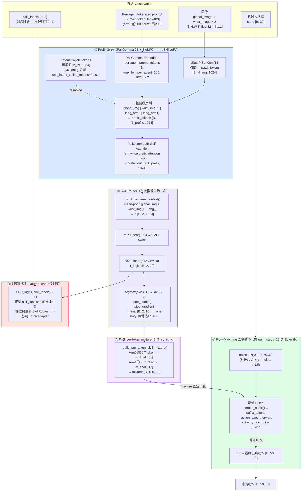
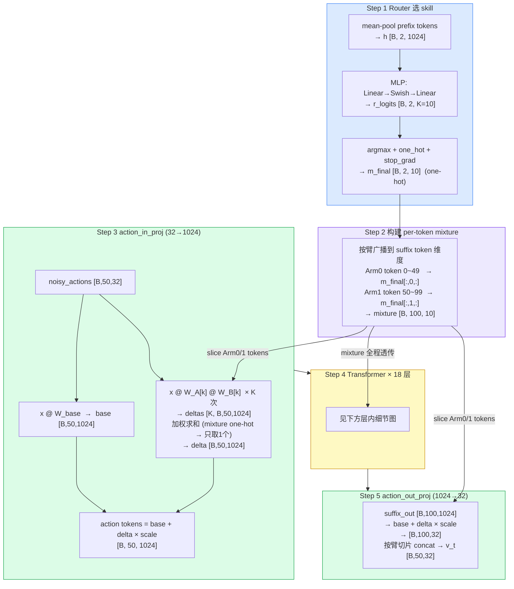
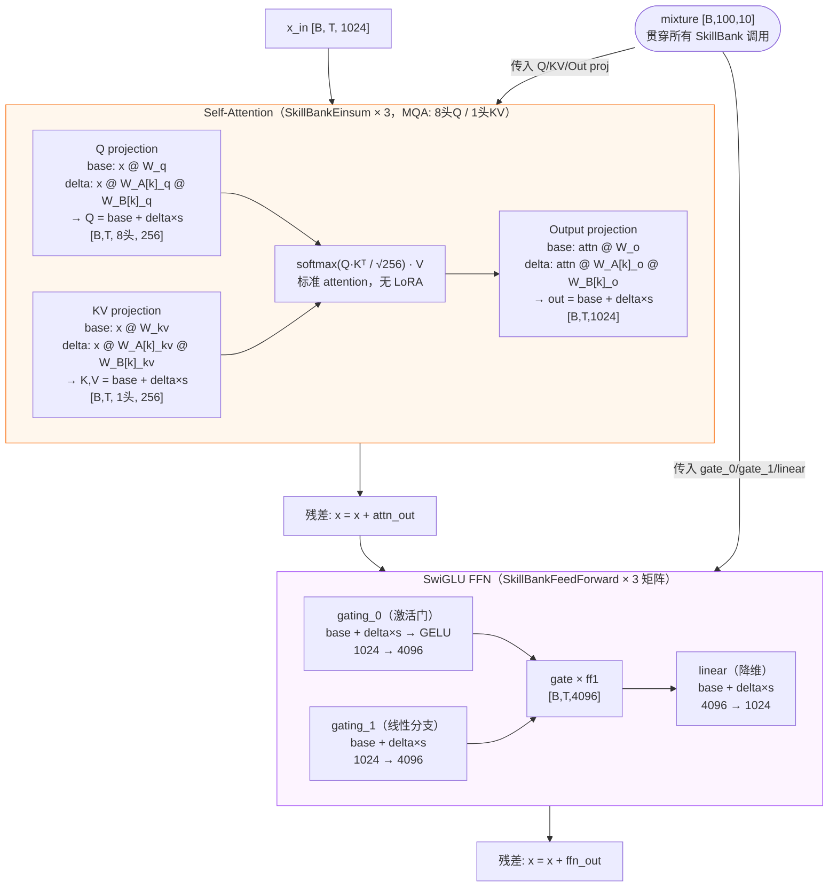
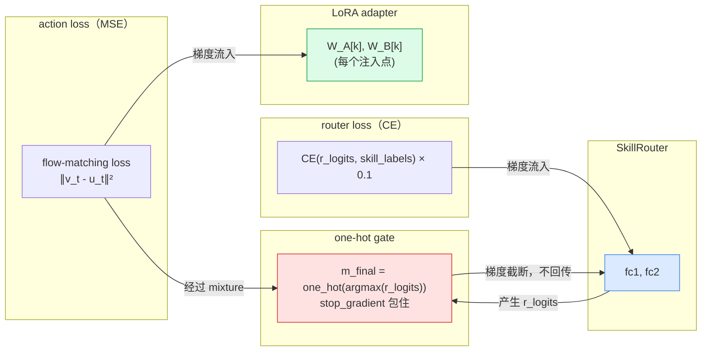

# Skill-LoRA: Hard Skill Selection for Multi-Arm VLA

## Overview

Skill-LoRA extends the Pi0.5 multi-arm Vision-Language-Action (VLA) model with a bank of **K skill-specific LoRA adapters** applied to the action expert. A lightweight **SkillRouter** MLP selects one skill per arm at each step via hard argmax. This replaces the soft mixture machinery (temporal prior, cross-arm attention) with a simple, interpretable design: each arm's action expert runs exactly one skill adapter, chosen by the router.

The router is trained with a cross-entropy loss against ground-truth `skill_labels`. The hard selection (`one_hot(argmax(logits))`) is detached from the gradient via `stop_gradient`, so the backbone adapters receive gradients only from the flow-matching action loss.

---

## Architecture

### 完整流程概览



---

### Action Expert 内部详细流程（SkillLoRA 注入）

> 以下展示一次 Euler 步中，suffix tokens 流经 Action Expert（gemma_300m，18 层）的完整路径。  
> `mixture [B, 100, 10]` 作为 conditioning 信号贯穿全程。

```mermaid
flowchart TD
    subgraph IN_PROJ["action_in_proj（SkillBankLinear: 32 → 1024）"]
        direction LR
        NA["noisy_actions\n[B, 50, 32]"]
        BASE_W["W_base [32, 1024]\n基础线性变换"]
        BASE_OUT["base = x @ W_base\n[B, 50, 1024]"]

        subgraph LORA_IN["SkillLoRA Delta（K=10 个 adapter bank）"]
            LA_IN["lora_a_bank [10, 32, 16]\nbsf,kfr → btkr"]
            LB_IN["lora_b_bank [10, 16, 1024]\nbtkr,kro → btko"]
            MIX_IN["einsum btk,btko→bto\n(one-hot: 只有1个skill非零)\ndelta [B, 50, 1024]"]
            LA_IN --> LB_IN --> MIX_IN
        end

        ADD_IN["action tokens = base + delta × scale\n[B, 50, 1024]"]
        NA --> BASE_W --> BASE_OUT --> ADD_IN
        NA --> LORA_IN --> ADD_IN
    end

    MIX_SRC(["mixture [B,100,10]\n来自 Skill Router"])
    MIX_SRC -->|"slice arm tokens"| LORA_IN

    subgraph TRANSFORMER["Action Expert Transformer × 18 Layer"]
        direction TB

        subgraph PRENORM["Pre-Attention RMSNorm + AdaRMSNorm\n(time embedding 作为 adarms_cond)"]
        end

        subgraph ATT["Self-Attention（MQA: 8头Query / 1头KV）— SkillBankEinsum × 3"]
            direction LR

            subgraph QP["Q Projection\nSkillBankEinsum\nshape=(8,1024,256)"]
                QW["W_q [8,1024,256]"]
                QA["w_a_bank [10,8,1024,16]"]
                QB["w_b_bank [10,8,16,256]"]
                QOUT["Q [B,T,8,256]\n= base + Σ_k mix[k]·(x@Wa[k]@Wb[k])·scale"]
                QW --> QOUT
                QA --> QOUT
                QB --> QOUT
            end

            subgraph KVP["KV Projection\nSkillBankEinsum\nshape=(2,1,1024,256)"]
                KVW["W_kv [2,1,1024,256]"]
                KVA["w_a_bank [10,2,1,1024,16]"]
                KVB["w_b_bank [10,2,1,16,256]"]
                KVOUT["K,V [B,T,1,256]\n= base + delta·scale"]
                KVW --> KVOUT
                KVA --> KVOUT
                KVB --> KVOUT
            end

            ROPE["RoPE位置编码\nScaled Dot-Product Attention\nprobs [B, 8/1, T, T]"]

            subgraph OP["Output Projection\nSkillBankEinsum\nshape=(8,256,1024)"]
                OW["W_o [8,256,1024]"]
                OA["w_a_bank [10,8,256,16]"]
                OB["w_b_bank [10,8,16,1024]"]
                OOUT["attn_out [B,T,1024]\n= base + delta·scale"]
                OW --> OOUT
                OA --> OOUT
                OB --> OOUT
            end

            QOUT --> ROPE
            KVOUT --> ROPE
            ROPE --> OOUT
        end

        RESID1["残差连接\nh = h + attn_out"]

        subgraph FFN_BLOCK["Feed-Forward（SwiGLU Gate）— SkillBankFeedForward"]
            direction LR

            subgraph GATE0["gating_0（激活门）\nW_g0 [1024,4096] + LoRA bank"]
                GW0["W_g0 base"]
                GA0["gating_einsum_a_bank\n[10, 2, 1024, 16][:,0]"]
                GB0["gating_einsum_b_bank\n[10, 2, 16, 4096][:,0]"]
                GOUT0["gate = GELU(base + delta·scale)\n[B,T,4096]"]
                GW0 --> GOUT0
                GA0 --> GOUT0
                GB0 --> GOUT0
            end

            subgraph GATE1["gating_1（线性分支）\nW_g1 [1024,4096] + LoRA bank"]
                GW1["W_g1 base"]
                GA1["gating_einsum_a_bank\n[10, 2, 1024, 16][:,1]"]
                GB1["gating_einsum_b_bank\n[10, 2, 16, 4096][:,1]"]
                GOUT1["ff1 = base + delta·scale\n[B,T,4096]"]
                GW1 --> GOUT1
                GA1 --> GOUT1
                GB1 --> GOUT1
            end

            ACT["activations = gate × ff1\n[B,T,4096]"]

            subgraph LIN["linear 投影\nW_lin [4096,1024] + LoRA bank"]
                LW["W_lin base"]
                LA2["linear_skill_lora_a_bank\n[10, 4096, 16]"]
                LB2["linear_skill_lora_b_bank\n[10, 16, 1024]"]
                LOUT["ffn_out = base + delta·scale\n[B,T,1024]"]
                LW --> LOUT
                LA2 --> LOUT
                LB2 --> LOUT
            end

            GOUT0 --> ACT
            GOUT1 --> ACT
            ACT --> LOUT
        end

        RESID2["残差连接\nh = h + ffn_out"]

        PRENORM --> ATT --> RESID1 --> FFN_BLOCK --> RESID2
    end

    MIX_SRC -->|"mixture 传入 Attn"| ATT
    MIX_SRC -->|"mixture 传入 FFN"| FFN_BLOCK

    subgraph OUT_PROJ["action_out_proj（SkillBankLinear: 1024 → 32）"]
        direction LR
        SO["suffix_out [B, 100, 1024]"]
        BASE_W2["W_base [1024, 32]"]
        BASE_OUT2["base [B, 100, 32]"]

        subgraph LORA_OUT["SkillLoRA Delta"]
            LA_OUT["lora_a_bank [10, 1024, 16]"]
            LB_OUT["lora_b_bank [10, 16, 32]"]
            MIX_OUT["delta [B, 100, 32]"]
            LA_OUT --> LB_OUT --> MIX_OUT
        end

        ADD_OUT["v_t_full = base + delta × scale\n[B, 100, 32]"]
        SPLIT["按臂切片输出:\nArm0: v_t[:,  0:50, :8]\nArm1: v_t[:, 50:100, :8]\nconcat → v_t [B, 50, 32]"]

        SO --> BASE_W2 --> BASE_OUT2 --> ADD_OUT
        SO --> LORA_OUT --> ADD_OUT
        ADD_OUT --> SPLIT
    end

    MIX_SRC -->|"slice arm tokens"| LORA_OUT

    ADD_IN --> TRANSFORMER
    TRANSFORMER --> OUT_PROJ
    SPLIT --> VT(["v_t [B,50,32]\n→ x_t += dt × v_t"])

    style IN_PROJ fill:#dcfce7,stroke:#16a34a
    style TRANSFORMER fill:#fef9c3,stroke:#ca8a04
    style ATT fill:#fff7ed,stroke:#f97316
    style FFN_BLOCK fill:#fdf4ff,stroke:#a855f7
    style OUT_PROJ fill:#dcfce7,stroke:#16a34a
```

---

### LoRA Delta 计算公式

对每一个挂载了 SkillLoRA 的线性变换，前向计算为：

```
output = x @ W_base
       + Σ_{k=0}^{K-1}  mixture[b,t,k] · (x @ W_a[k] @ W_b[k]) · (alpha / rank)
```

由于 `mixture` 是 **one-hot**，上式等价于：

```
skill = argmax(r_logits[b, arm])          # 当前臂选中的 skill 编号
output = x @ W_base
       + (x @ W_a[skill] @ W_b[skill]) · scale
```

即 **只有一个 adapter 生效**，其余 K-1 个 adapter 的权重在本次 forward 中不被使用。

---

## LoRA 注入详解

### 总流程



---

### Step 2 细节：mixture 如何区分两条臂

Arm0 选了 skill 3，Arm1 选了 skill 5，`mixture` 展开后如下：

```
token 位置   归属   mixture[b, t, :]          实际激活的 adapter
─────────────────────────────────────────────────────────────
t = 0~49    Arm0   [0,0,0,1,0,0,0,0,0,0]    W_A[3], W_B[3]
t = 50~99   Arm1   [0,0,0,0,0,1,0,0,0,0]    W_A[5], W_B[5]
```

同一次矩阵计算里，前 50 行 token 用 skill 3 的 adapter，后 50 行用 skill 5 的 adapter，**没有任何 if/else**，全靠 mixture 的逐 token 系数自动区分。

---

### Step 3/5 细节：SkillBankLinear 注入公式

> 适用于 `action_in_proj`（32→1024）和 `action_out_proj`（1024→32）

```
输入 x [B, T, d_in]
        │
        ├──────────────────────────────────────────┐
        │  base 路径                               │  LoRA 路径（K 个并行）
        ▼                                          ▼
   x @ W_base                            x @ W_A[0] @ W_B[0]  →  delta_0
   [B, T, d_out]                         x @ W_A[1] @ W_B[1]  →  delta_1
        │                                   ...
        │                                x @ W_A[9] @ W_B[9]  →  delta_9
        │                                          │
        │                                mixture 加权求和
        │                                (one-hot → 只有1个非零)
        │                                          │
        │                                    delta [B,T,d_out]
        │                                          │
        └──────────── + delta × scale ─────────────┘
                               │
                             output
```

**简化公式**（one-hot mixture 下等价于）：

```
k    = argmax(mixture[b, t, :])       # 被选中的 skill
output = x @ W_base  +  (x @ W_A[k] @ W_B[k]) × (alpha/rank)
                         ↑
                   只有这一个 adapter 生效，其余 K-1 个系数为 0
```

参数尺寸（本 config，K=10，rank=16）：

| 模块 | W_base | W_A bank | W_B bank |
|---|---|---|---|
| action_in_proj | (32, 1024) | (10, 32, 16) | (10, 16, 1024) |
| action_out_proj | (1024, 32) | (10, 1024, 16) | (10, 16, 32) |

---

### Step 4 细节：Transformer 层内注入位置



**各注入点参数尺寸**（每层，K=10，rank=16）：

| 注入点 | W_base 形状 | W_A bank 形状 | W_B bank 形状 |
|---|---|---|---|
| Q proj | (8, 1024, 256) | (10, 8, 1024, 16) | (10, 8, 16, 256) |
| KV proj | (2, 1, 1024, 256) | (10, 2, 1, 1024, 16) | (10, 2, 1, 16, 256) |
| Out proj | (8, 256, 1024) | (10, 8, 256, 16) | (10, 8, 16, 1024) |
| FFN gating | (2, 1024, 4096) | (10, 2, 1024, 16) | (10, 2, 16, 4096) |
| FFN linear | (4096, 1024) | (10, 4096, 16) | (10, 16, 1024) |

×18 层，所有 W_base **不动**，只有 W_A bank / W_B bank 从头训练。

---

### 梯度隔离



- **action loss → LoRA**：教每个 adapter "这个 skill 对应的动作该怎么做"
- **router loss → Router**：教 Router "看到这种观测应该选哪个 skill"
- **stop_gradient**：两条路径完全隔离，互不干扰

---

## Core Components

### 1. Skill Bank LoRA Primitives (`skill_lora.py`)

#### `SkillLoRAConfig`

| Field | Default | Description |
|-------|---------|-------------|
| `num_skills` | — | Number of skills K |
| `rank` | — | LoRA rank r |
| `alpha` | 1.0 | Scaling factor (`alpha/rank`; or `alpha/√rank` for RSLoRA) |
| `rslora` | False | Use RSLoRA scaling |

With the default config (`rank=16, alpha=16.0`) the effective delta scale is **1.0**.

#### Mixing primitive

All three backends share the same combine operation:

```python
# mixture: [B, S, K],  deltas: [K, *out_shape]  →  *out_shape
delta = jnp.einsum("bsk,k...->...", mixture, deltas)
```

When `mixture` is one-hot, this simply selects the single active skill's delta.

#### `SkillBankEinsum` — Gemma attention (QKV / output projections)

Stores `w_a_bank [K, *shape_a]` and `w_b_bank [K, *shape_b]`. Uses `jax.vmap` to compute per-skill LoRA deltas, then mixes. With a one-hot mixture this is equivalent to loading one adapter.

#### `SkillBankFeedForward` — Gemma FFN (gating + linear)

Per-skill banks for both gating slices and the linear projection. Gating handled via `_dot_gating_skill`; linear via `_dot_skill`.

#### `SkillBankLinear` — action in/out projections (NNX)

```python
result   = x @ W_base
lora_a   = einsum("btf,kfr->btkr", x, lora_a_bank)
lora_out = einsum("btkr,kro->btko", lora_a, lora_b_bank)
delta    = einsum("btk,btko->bto", mixture, lora_out)   # one-hot: single skill
output   = result + delta * scaling_value
```

---

### 2. `SkillRouter`

A 2-layer MLP mapping per-arm pooled context to skill logits:

```
h [B, A, D]  →  Linear(D, D/2)  →  Swish  →  Linear(D/2, K)  →  r_logits [B, A, K]
```

Hard selection at forward time:

```python
idx     = jnp.argmax(r_logits, axis=-1)            # [B, A]
m_final = jax.lax.stop_gradient(
              jax.nn.one_hot(idx, num_skills))      # [B, A, K]
```

`m_final` is broadcast to all `action_horizon` tokens for each arm:
`mixture[b, t, :] = m_final[b, agent, :]` for tokens belonging to that arm.

---

### 3. `Pi0SkillLoRAComposer` — Full Model

#### Config (`Pi0SkillLoRAComposerConfig`)

| Field | Default | Description |
|-------|---------|-------------|
| `num_skills` | 10 | Number of skill adapters K |
| `skill_lora_rank` | 16 | LoRA rank |
| `skill_lora_alpha` | 16.0 | LoRA alpha |
| `apply_skill_lora_to_action_expert` | True | Apply SkillBank to Gemma 300M attn + FFN |
| `apply_skill_lora_to_decoder` | True | Apply SkillBank to action in/out projections |
| `router_loss_weight` | 0.1 | Weight of router CE loss |

The PaliGemma 2B backbone receives **no skill LoRA** — adapters are injected only into the 300M action expert.

#### Training forward pass (`compute_loss`)

1. Prefix forward — images + per-agent prompts through SigLIP + PaliGemma (no LoRA).
2. Mean-pool prefix tokens per arm → `h [B, A, D]`.
3. Router → `r_logits`; argmax + one_hot + stop_gradient → `m_final [B, A, K]`.
4. Broadcast `m_final` to suffix token ranges → `mixture [B, T_suffix, K]`.
5. Suffix forward — flow-matching with skill LoRA active in action expert.
6. Total loss = flow-matching MSE + `router_loss_weight × CE(router, skill_labels)`.

#### Inference (`sample_actions`)

Same router argmax selects the skill. `per_token_mixture` is fixed for the entire Euler integration loop; KV cache is used for the prefix.

---

### 4. Auxiliary Skill Loss

When `skill_labels` are provided (per-arm integer index, or `-1` for unlabeled):

```python
log_probs = log_softmax(r_logits)
loss_r = sum(valid * -sum(one_hot(labels) * log_probs, axis=-1)) / (sum(valid) + 1e-8)
total_aux = router_loss_weight * loss_r
```

Unlabeled samples (`label == -1`) are masked out. The router logits receive gradients from this loss; the one-hot gate used in the forward pass is detached.

---

## Data Pipeline

### Observation Fields

| Field | Shape | Description |
|-------|-------|-------------|
| `skill_labels` | `[B, A]` | Integer skill label per arm (−1 = unlabeled) |

### Transforms

#### `SkillLabelFromTaskIndex`

Loads `skill_labels.jsonl`: `task_index → [skill_id_arm0, skill_id_arm1]`. Applied during training when `skill_labels_path` is set.

#### `EnsureSkillFields`

Ensures `skill_labels` is present; defaults to `-1` (unlabeled) for all arms.

### `SkillLoRAModelTransformFactory`

Full model-side transform pipeline:

```
InjectDefaultPrompt (optional)
→ SkillLabelFromTaskIndex (if skill_labels_path set)
→ EnsureSkillFields
→ TokenizePerAgentPrompt
→ PadStatesAndActions
```

---

## Training Configuration

### Config name: `aevla_pi05_skill_lora_two_arms_multitask`

| Parameter | Value |
|-----------|-------|
| **Model** | `Pi0SkillLoRAComposerConfig` |
| `num_agents` | 2 |
| `action_dim_per_agent` | 8 |
| `action_horizon` | 50 |
| `max_token_len_per_agent` | 200 |
| `num_skills` | 10 |
| `skill_lora_rank` | 16 |
| `skill_lora_alpha` | 16.0 |
| `router_loss_weight` | 0.1 |
| `num_latent_collab_tokens` | 4 |
| **Dataset** | `multi_task_combined` |
| **Skill labels** | `dataset/multi_task_combined/meta/skill_labels.jsonl` |
| **Base weights** | Pi0.5 base checkpoint |
| **Steps** | 15,000 |
| **Batch size** | 32 |
| **LR schedule** | Cosine, peak 5e-5, warmup 1000 steps |
| **FSDP devices** | 2 |

### Default skill vocabulary

| Index | Skill |
|-------|-------|
| 0 | pick |
| 1 | place |
| 2 | lift |
| 3 | align |
| 4 | handover |
| 5 | receive |
| 6 | wait |
| 7 | press |
| 8 | pull |
| 9 | push |

> Note: these names are documentation only. Actual labels are determined by `skill_labels.jsonl`.

---

## Weight Loading

`Pi0SkillLoRAComposerWeightLoader` loads the Pi0.5 base checkpoint and **randomly initializes** all skill-LoRA–specific parameters:

```
skill_lora_a_bank, skill_lora_b_bank
lora_a_bank, lora_b_bank
gating_einsum_skill_lora_*, linear_skill_lora_*
skill_router, latent_collab_tokens
time_mlp_in, time_mlp_out
```

The PaliGemma and base action expert weights (without skill banks) load from the checkpoint.

---

## Running Training

```bash
# Step 1: compute normalization statistics
uv run scripts/compute_norm_stats.py \
    --config-name aevla_pi05_skill_lora_two_arms_multitask

# Step 2: train
XLA_PYTHON_CLIENT_MEM_FRACTION=1 uv run scripts/train.py \
    aevla_pi05_skill_lora_two_arms_multitask \
    --exp-name aevla_pi05_skill_lora_two_arms_multitask \
    --overwrite
```

Or use the convenience script:

```bash
bash scripts/run_multitask_pi05_skill_lora.sh
```

---

## Key Design Decisions

### 1. Skill LoRA on action expert only
PaliGemma 2B is unchanged. All skill conditioning flows through the 300M action expert, preserving pretraining compatibility.

### 2. Hard top-1 selection
Each arm selects exactly one skill adapter via `argmax`. The one-hot gate is detached from the gradient (`stop_gradient`), so the adapter weights receive gradients only from the action loss, while the router is supervised purely by cross-entropy against `skill_labels`.

### 3. Per-arm constant mixture over horizon
`m_final` is computed once per arm per step and broadcast to all `action_horizon=50` tokens for that arm.

### 4. Fixed K = 10 skills as vocabulary
Skills are a fixed finite vocabulary, not one adapter per dataset task. The router learns to map context to the appropriate skill index.

### 5. Supervised routing for interpretability
CE loss on `r_logits` against `skill_labels` trains the router toward categorical skill selection. Unlabeled samples (label `-1`) are masked out.

---

## File Reference

| File | Role |
|------|------|
| `src/openpi/models/skill_lora.py` | Skill bank primitives (`SkillBankEinsum`, `SkillBankFeedForward`, `SkillBankLinear`) |
| `src/openpi/models/pi0_skill_lora_composer.py` | Full model: `SkillRouter` + train/infer loop |
| `src/openpi/models/gemma.py` | Plugs skill banks into Gemma attention and FFN |
| `src/openpi/models/model.py` | `Observation` field: `skill_labels` |
| `src/openpi/transforms.py` | `SkillLabelFromTaskIndex`, `EnsureSkillFields` |
| `src/openpi/training/config.py` | `SkillLoRAModelTransformFactory` + `TrainConfig` |
| `src/openpi/training/weight_loaders.py` | `Pi0SkillLoRAComposerWeightLoader` |
| `src/openpi/models/skill_lora_test.py` | Smoke tests: forward pass, one-hot `m_final` assertion |
| `scripts/run_multitask_pi05_skill_lora.sh` | Convenience training script |
